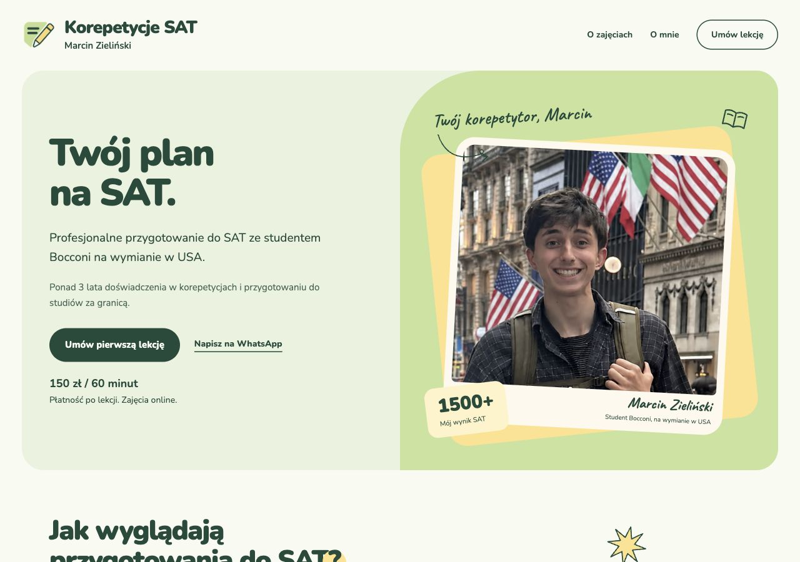
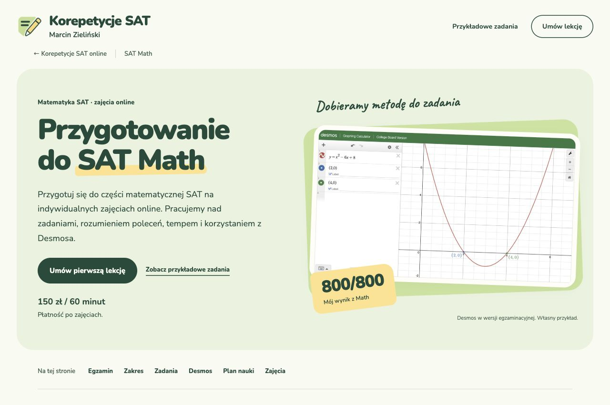
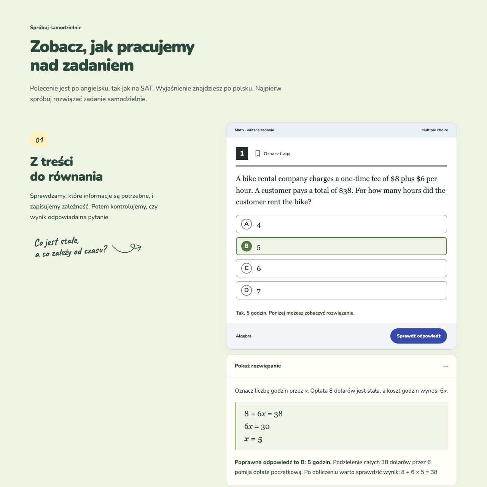

# Korepetycje SAT

A Polish website for my SAT tutoring work, with interactive examples, practical exam guides and lesson booking.

[korepetycjesat.pl](https://korepetycjesat.pl/)

<table>
  <tr>
    <td><a href="assets/website.jpg"></a></td>
    <td><a href="assets/math.jpg"></a></td>
  </tr>
</table>

## Why I built it

I teach SAT preparation, so I wanted a website that showed what working with me actually looks like. A student should be able to try a question, read an explanation and understand the lessons before deciding to get in touch.

The website also gives me a place to answer questions I hear repeatedly: how to use Bluebook, when Desmos helps, how SAT registration works in Poland and where the test fits into applications abroad.

I worked on the design, Polish writing, interactive examples, build system, search metadata, booking integration and analytics.

## Letting students try the material

The Math page includes original questions with selectable answers, answer checking, review flags and worked solutions. Reading and Writing has its own examples. The questions stay in English, as they are on the exam, while the explanations are in Polish.

<table>
  <tr>
    <td><a href="assets/example.jpg"></a></td>
  </tr>
</table>

The visual layout refers to Bluebook so the exercise feels familiar, but the practice questions are my own examples. Real Bluebook and Desmos screenshots are labeled separately and can be opened at full size.

These are small teaching interactions, rather than a full practice-test platform. Their purpose is to explain a method and give a student a useful first experience of the lessons.

## How the site is built

The pages are static HTML and CSS with JavaScript for the exercises, image viewers, booking and analytics. A small Node build generates the published pages and bundles the scripts with esbuild.

I kept the content in the HTML so someone can read the guides without waiting for a client-side application to load. The site has separate pages for Math, Reading and Writing, Bluebook, Desmos, registration, test dates and admissions.

```text
Page content + shared site settings
                 |
          Node / esbuild
                 |
        Static pages on Vercel
          /              \
   Lesson booking     Exam guides
      (Cal.com)       and exercises
```

## A few details I spent time on

**Useful search pages.** Each guide answers a specific question and has its own title, description, canonical URL and structured data. The build produces the sitemap and keeps preview deployments out of search indexing. Exam and admissions information links to the original sources and includes a review date.

**Images and fonts.** The design uses real photos and screenshots, so I worked on responsive image sizes, modern image formats and smaller font files. The goal was to keep the visual style without making someone on a phone download the full-size originals.

**Booking without rebuilding a calendar.** Cal.com handles availability and booking. The page also provides an external calendar link and WhatsApp contact if the embedded calendar does not load.

**Measuring the right action.** Clicking a booking button, submitting a booking and attending a paid lesson are different events. The tracking preserves that distinction. A WhatsApp click is not counted as a sent message.

**Consent before Google Analytics.** GA4 loads after explicit agreement, with equal accept and reject options and a way to change the choice later. Analytics events exclude form contents and student contact details. The site also respects Do Not Track and Global Privacy Control for GA4.

## Built with

- **HTML, CSS and JavaScript** for the pages and interactive teaching examples.
- **Node.js and esbuild** for the static build and bundled scripts.
- **Cal.com** for lesson availability and booking.
- **GA4 and Vercel Web Analytics** for consented event measurement and page analytics.
- **GitHub Actions and Vercel** for automated checks, previews and production releases.

## Status and source

The [website](https://korepetycjesat.pl/) is live and supports my tutoring work. This repository is a public showcase; the website source remains private.

Korepetycje SAT is an independent tutoring service and is not affiliated with College Board, Bluebook or Desmos.
